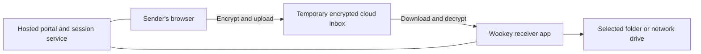

# Gloryhole: hosting, speed, and end-to-end encryption

Prepared for Wookey Films · November 10, 2026

## Recommended direction

For a dependable Wookey Films service, use a hosted upload portal with temporary encrypted cloud storage and a small receiver app on the studio Mac. The sender still opens a link without an account. The receiver app writes completed files and reports to your chosen local or mounted network folder.

The browser cannot directly write to a folder on a different computer. A receiver must remain part of the system even when the website is fully hosted. Cloud storage allows the sender’s upload to finish while the Mac is offline; the Mac downloads, verifies, and decrypts it when it reconnects. The interface should distinguish **uploaded to the inbox** from **confirmed saved on the receiver**.

This is a proposed production architecture. The current build uses an online Mac and a temporary tunnel; it has not been migrated to this architecture.

## Two practical ways to go live

| Option | What changes | Tradeoff |
| --- | --- | --- |
| Studio-hosted service | An always-on Mac or small studio server, stable domain, production tunnel, automatic startup and monitoring | Least architectural change; uploads depend on studio power, internet, and disk availability |
| Hosted cloud inbox plus receiver app | Hosted portal/API, database, temporary object storage, background jobs, receiver app | More work and storage/transfer costs, but supports offline receiving and better recovery |

The first option is suitable for a small internal rollout. Replace the temporary tunnel with a managed tunnel and a stable address such as `files.wookeyfilms.com`, subject to domain access. Keep the local administration interface private. Cloudflare documents Quick Tunnels as development/testing tools without an uptime guarantee; its production setup uses an account, domain, and a regular tunnel. [Quick Tunnel limitations](https://developers.cloudflare.com/tunnel/get-started/quick-tunnels/), [production setup](https://developers.cloudflare.com/tunnel/get-started/).

For a full hosted service, the work includes:

1. Register/configure the chosen domain and separate production and test environments.
2. Host the portal and session API with HTTPS, deployment rollback, health checks, and owner authentication.
3. Replace local JSON state with a transactional database and a job queue. Make uploads and receipts safe to retry without duplicate files or false success reports.
4. Add temporary object storage with multipart uploads, resumability, explicit expiry, cleanup of abandoned uploads, and capacity limits.
5. Package and sign the receiver app, protect credentials in the Mac’s Keychain, add reliable startup/reconnection, and provide controlled updates.
6. Add monitoring, support diagnostics, private backups of account/session settings, and tested recovery from server, disk, network, and receiver failures.
7. Test large film files, simultaneous senders, interrupted uploads, changing networks, slow NAS writes, and offline receivers before a controlled rollout.

No hosting account, paid plan, DNS change, or production deployment was created in this update. Costs depend mainly on monthly upload volume, storage retention, cloud egress, and concurrent transfers; measure those before choosing a plan.

## Keeping transfers fast

Speed is bounded by the slowest part of the path: sender upload, receiver download, relay/storage throughput, encryption, and disk/NAS writes. Hosting alone cannot overcome a slow sender connection.

For scale, 100 Mbps is at most 12.5 MB/s and 1 Gbps is at most 125 MB/s before overhead. A 100 GB file takes at least about 13 minutes 20 seconds over a fully available 1 Gbps connection; real transfers take longer.

I recommend:

- Wired Ethernet and fast local storage at the studio; measure the NAS independently before blaming the internet.
- Resumable multipart uploads with bounded parallelism. Tune concurrency and chunk size using measurements; do not launch unlimited parallel transfers. AWS documents parallel parts and independent retries as multipart-upload benefits. [Multipart uploads](https://docs.aws.amazon.com/AmazonS3/latest/userguide/mpuoverview.html).
- A storage region and relay placement chosen from the actual locations of your senders and studio. Benchmark representative routes.
- Streaming file data with bounded memory, background encryption/hash workers, and asynchronous report logging outside the main transfer path.
- Avoiding unnecessary full-file copies and rereads. The current prototype stages files locally, reads them for hashing, then copies to the destination. That is reliable for a prototype but adds disk traffic and a final saving phase.
- Clear measurements of network transfer time, verification time, destination-writing time, retries, and confirmed delivery. A fast-looking browser progress bar is not a confirmed file save.

An optional later optimization is direct WebRTC transfer when both ends are online, with relay/storage fallback. Direct connectivity is not always possible; TURN relay infrastructure is needed for some networks, and relaying can affect cost and speed. [WebRTC connection setup](https://webrtc.org/getting-started/peer-connections), [TURN servers](https://webrtc.org/getting-started/turn-server).

## Can it be end-to-end encrypted?

Yes. The current application is **not** end-to-end encrypted: HTTPS protects the connection, but Cloudflare is a trusted intermediary, and files are saved as ordinary files on the Mac.

For the hosted inbox design, encryption should happen in the sender’s browser before uploading. The Mac should hold the recipient’s private key and decrypt locally. Storage and relay services would carry ciphertext rather than readable files. A sender does not need an account to encrypt to Wookey’s public key.

Use an established, reviewed streaming-encryption design rather than inventing a new cryptographic format. For example, libsodium documents authenticated file streams and anonymous encryption to a recipient’s public key; Web Crypto also supplies standard cryptographic primitives. These are building blocks, not a complete audited transfer protocol. [Streaming encryption](https://doc.libsodium.org/secret-key_cryptography/secretstream), [recipient public-key encryption](https://doc.libsodium.org/public-key_cryptography/sealed_boxes), [Web Crypto](https://www.w3.org/TR/webcrypto/).

The production design needs recipient-key authentication, private-key protection and recovery, encrypted filenames/reports where appropriate, safe chunk sequencing/retries, integrity verification, versioned formats, and an independent security review. Losing the only decryption key can make queued files unrecoverable. A compromised web frontend could replace encryption code or the advertised public key, so secure deployment and authenticating the receiver key are essential to the security claim.

WebRTC data channels also use encryption between endpoints, but require authenticated peer setup; choosing WebRTC alone does not establish that the recipient is the intended Wookey device. [WebRTC security architecture](https://www.rfc-editor.org/rfc/rfc8827.html).

Transport encryption is compatible with high throughput, but performance must be benchmarked on the actual browser, Mac, and network. End-to-end encryption is a separate implementation milestone; it was not added by this update.

## Short links

You chose to keep the current links. This build does not contact a shortening service or send upload capabilities to a new third party.

A Wookey-controlled short domain is the preferable production option. Keep short human-friendly locators separate from strong upload authorization where possible. Shortening the code reduces its resistance to guessing; a short address does not replace expiry, revocation, attempt limits, or authentication. Never put a decryption private key in a short-link service’s mapping.

## Reports in this build

Each new sending session has a separate report containing the sender’s optional self-reported name, file outcomes, byte counts, UTC timestamps, confirmed checksums, and average rates for completed files. Browser sessions receive a downloadable text report; supported browsers can save it to a folder the sender explicitly chooses, including the originals’ folder.

The receiver saves the report in the destination selected when that session begins and retains a private local record. If the destination is missing or unwritable, the report is queued and remains downloadable in the control panel. Reconnect and reselect the original destination if its mount identity has changed. Existing received files are not moved.

No program can force a download after the sender has closed the browser, or write to an unavailable drive. The receiver records abandoned sessions as interrupted after the idle timeout or on restart. A sender attempt that never reaches the receiver can only have a local report. Sender names are not authenticated identities, and a missing acknowledgment is not treated as proof that a file arrived.
